# Atlas of observed results

Frames inspected in Chrome with audio muted on 29–30 September 2026. New additions were inspected on 30 September. Each image links to the video and relevant passage. The image documents composition; playback shows motion. Test the implemented website using the recipe's result check.

## Index

- [Microphone in exploded view](#4ktew-_lkk8)

- [Café heading and photographic window](#1y8olbgafde)

- [VR headset and entry action](#3t3togeridw)

- [Landscape with route and data](#1a20nupbkoc)

- [Spherical photographic portfolio](#vhrphmz3ahe)

- [Watch in the opening section](#mfgrgsognpm)

- [Empty state with a first action](#saxkk5fbjbc)

- [Liveline chart](#jhx7n9uakhg)

- [OriginKit catalog](#8gfwkfyaaw4)

- [Conic-gradient border](#mwdvthtamo8)

- [Navigation with Lottie animation](#4nywv37ayjs)

- [React Bits effects and components](#9nubqbsnbjg)

- [WordPress page after import](#rbbus1k8r8g)

- [CSS card with depth](#wmsiyyisf_4)

- [Dashboard anchor screen](#h1l66nhu-_8)

- [Hierarchy in application screens](#mvopq3wrnbo)

- [Consultancy website after revision](#lxlmmumljpw)

- [Product identity retained above the catalog](#ggg61sdejei)

- [Useful report findings before saving](#2tlig3voky8)

- [Booking total and cancellation beside the action](#zr37ibqxl1u)

- [Food search and browse entry](#uswp7w9bkc0)

- [Track identity and playback position](#yt_afozedc8)

- [Data table and its secondary controls](#ksx9c2-3ymo)

- [Radial distortion around display text](#72xchvm08ji)

- [Colored halftone letter](#72xchvm08ji-875)

- [A feature shown through its product interface](#pdcqjopby1k)

- [A product operation in the opening section](#dbjoepxxqdg)

- [Editable product timing before final styling](#oiulpvtj-0e)

- [A spherical graphic in a hero concept](#q1qqn08zk6i)

## 4Ktew-_lkk8

### Microphone in exploded view

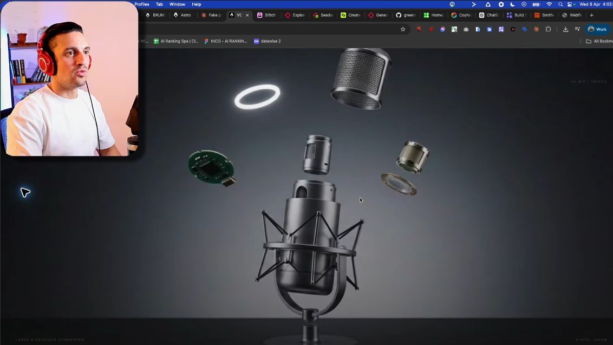

The frame shows separated parts and product-page captions. Open the original passage to observe motion.

[Video · 14:40](https://www.youtube.com/watch?v=4Ktew-_lkk8&t=880s) — Nico | AI Ranking. Recipes and combinations: S01, M02.

## 1Y8OlBgafdE

### Café heading and photographic window

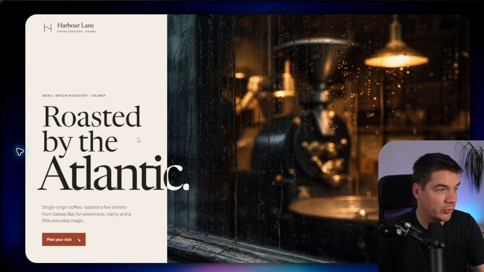

Initial composition of the section that expands in the tutorial.

[Video · 1:52](https://www.youtube.com/watch?v=1Y8OlBgafdE&t=112s) — The AI Automators. Recipes and combinations: S03, S04, M03.

## 3t3TogERIdw

### VR headset and entry action

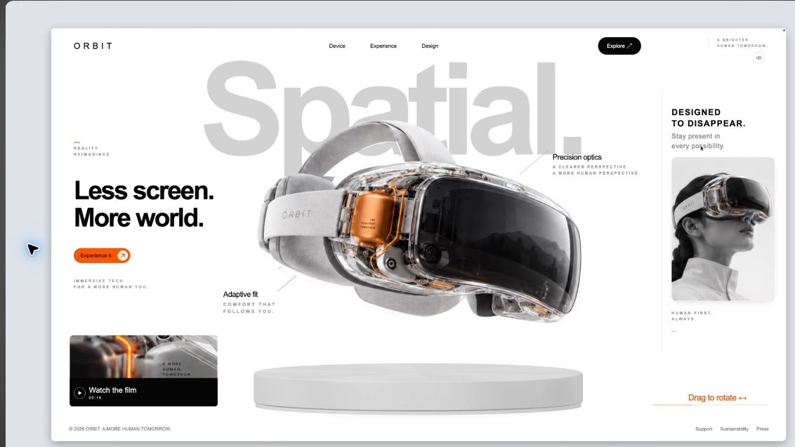

Showroom opening; image-plane tilt and model rotation are distinct variants.

[Video · 14:10](https://www.youtube.com/watch?v=3t3TogERIdw&t=850s) — Komputer Mechanic. Recipes and combinations: T04, M06.

## 1A20nUPbkOc

### Landscape with route and data

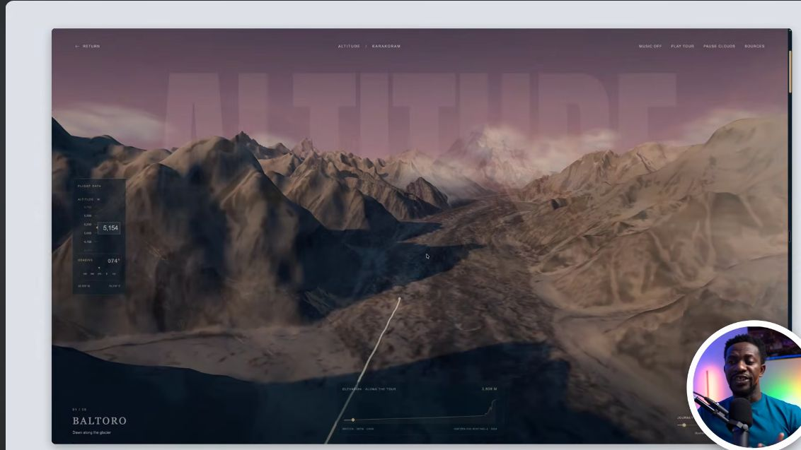

A mountain journey with route data and panels.

[Video · 13:51](https://www.youtube.com/watch?v=1A20nUPbkOc&t=831s) — Komputer Mechanic. Recipes and combinations: T03, M07.

## VHrpHmZ3AhE

### Spherical photographic portfolio

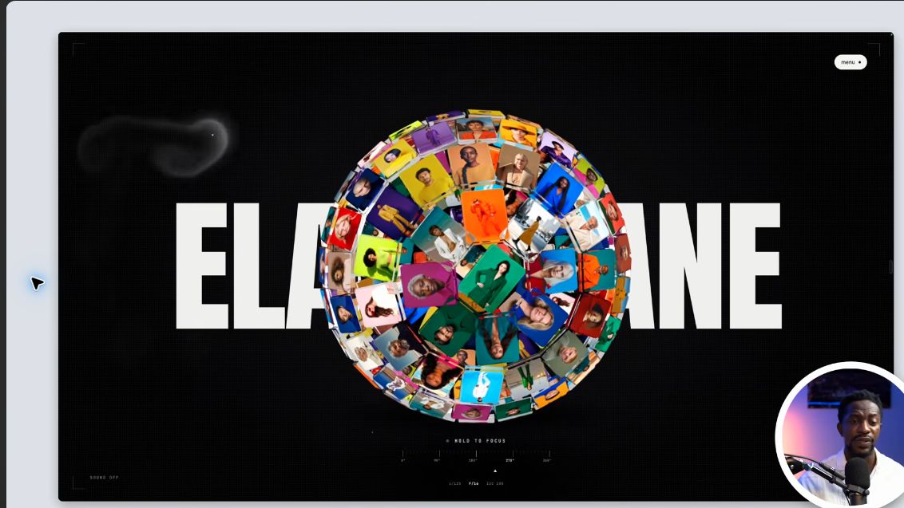

Photos arranged in space; the recipe includes a grid transition.

[Video · 18:20](https://www.youtube.com/watch?v=VHrpHmZ3AhE&t=1100s) — Komputer Mechanic. Recipes and combinations: T01, T02, M05.

## mFgRGSOGNPM

### Watch in the opening section

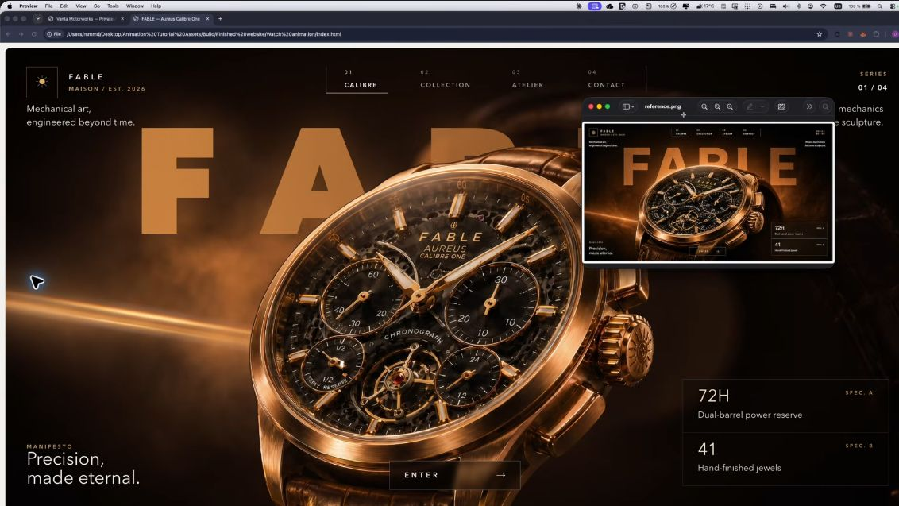

Static composition before photographic animation.

[Video · 13:01](https://www.youtube.com/watch?v=mFgRGSOGNPM&t=781s) — Komputer Mechanic. Recipes and combinations: P02, S01, M01.

## SAxKK5fbjbc

### Empty state with a first action

Application example from an initial video: copy, illustration, and control.

[Video · 4:50](https://www.youtube.com/watch?v=SAxKK5fbjbc&t=290s) — Wyatt Feaster. Recipes and combinations: A07, M09.

## Jhx7n9uAKHg

### Liveline chart

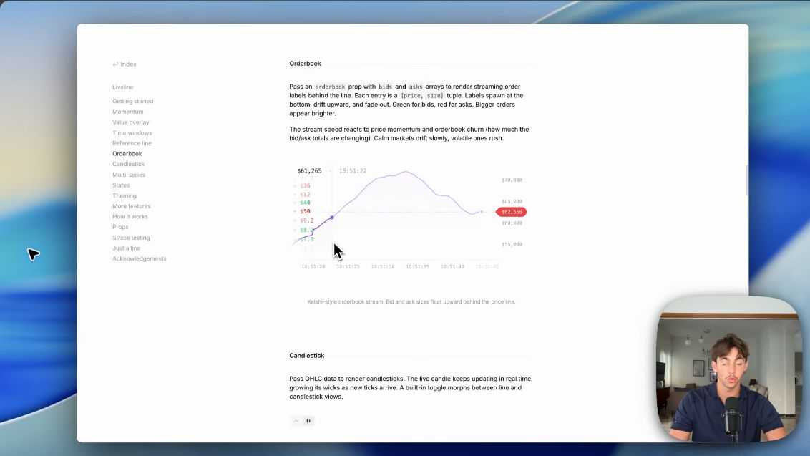

The author demonstrates a live chart; the frame preserves one visualization state.

[Video · 4:16](https://www.youtube.com/watch?v=Jhx7n9uAKHg&t=256s) — Adrien | AI Designer. Recipes and combinations: A03, M10.

## 8GfWKFyAaW4

### OriginKit catalog

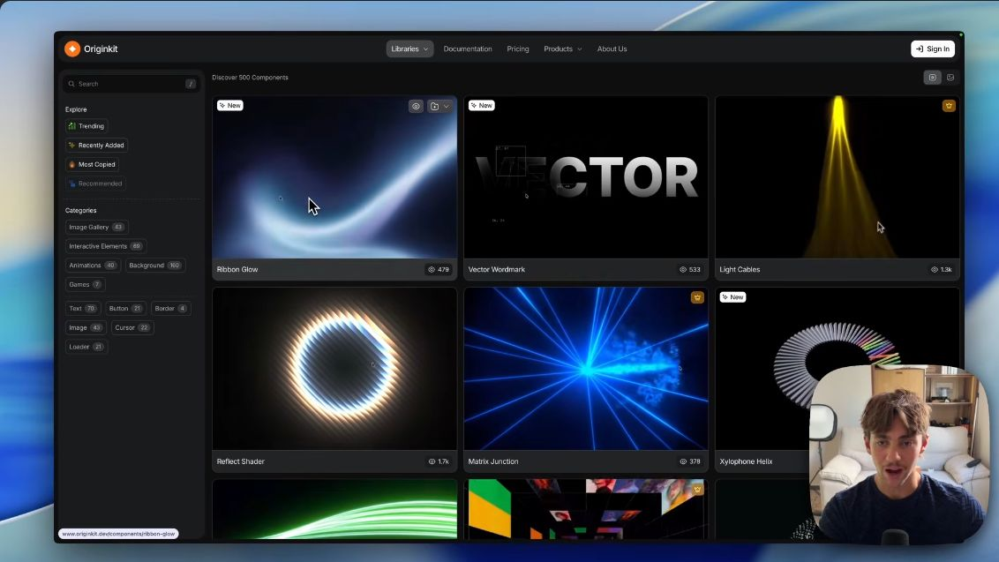

Examples from the first video; the dedicated reference documents access and licenses.

[Video · 2:45](https://www.youtube.com/watch?v=8GfWKFyAaW4&t=165s) — Adrien | AI Designer. Recipes and combinations: C12.

## mwDvTHTAmo8

### Conic-gradient border

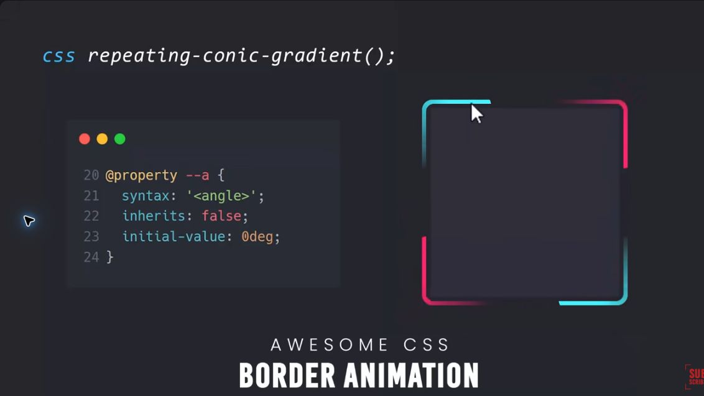

Demonstration of an angular property and decorative layer.

[Video · 0:13](https://www.youtube.com/watch?v=mwDvTHTAmo8&t=13s) — Online Tutorials. Recipes and combinations: C05.

## 4nywV37ayjs

### Navigation with Lottie animation

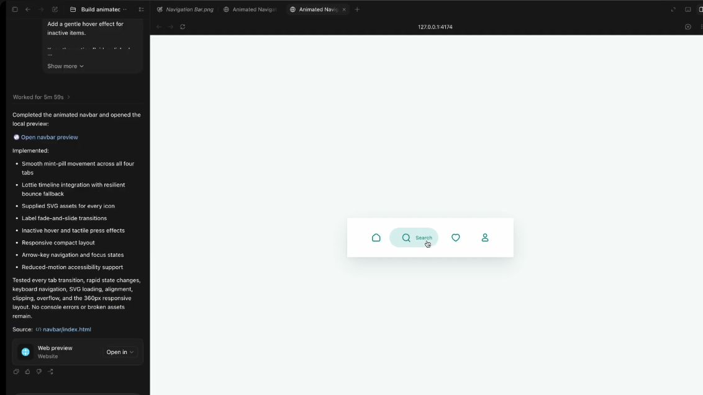

Codex and the local navigation preview; inspect the controls alongside the original passage.

[Video · 4:14](https://www.youtube.com/watch?v=4nywV37ayjs&t=254s) — Hongzhao. Recipes and combinations: V03.

## 9NubqbSNbjg

### React Bits effects and components

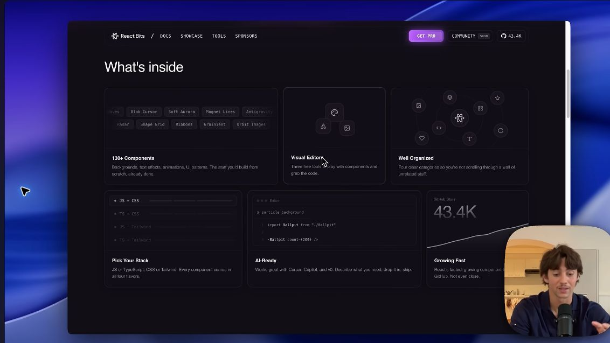

The author shows CSS/Tailwind variants, visual editors, and components; select the effect from its official source.

[Video · 2:41](https://www.youtube.com/watch?v=9NubqbSNbjg&t=161s) — Adrien | AI Designer. Recipes and combinations: C02, C03, C09, C10.

## Rbbus1K8R8g

### WordPress page after import

The plumbing-service website after conversion and builder revision.

[Video · 14:46](https://www.youtube.com/watch?v=Rbbus1K8R8g&t=886s) — Er Suraj Verma. Recipes and combinations: W01, M13.

## WmSiyyisF_4

### CSS card with depth

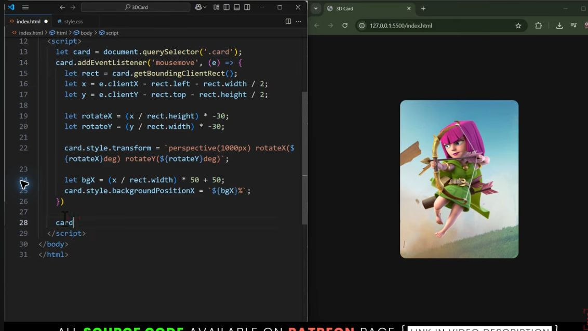

A construction step for tilt and parallax.

[Video · 4:31](https://www.youtube.com/watch?v=WmSiyyisF_4&t=271s) — Online Tutorials. Recipes and combinations: C04.

## H1l66NhU-_8

### Dashboard anchor screen

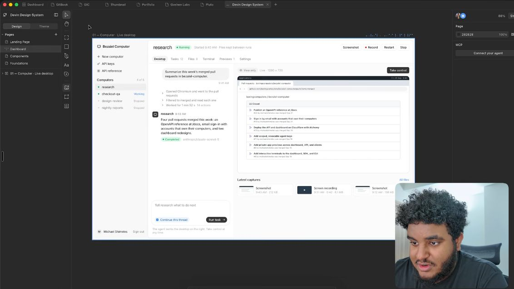

The result of iterating on the product's main screen.

[Video · 14:15](https://www.youtube.com/watch?v=H1l66NhU-_8&t=855s) — Ras Mic. Recipes and combinations: P03, M10.

## MVOpq3WRnbo

### Hierarchy in application screens

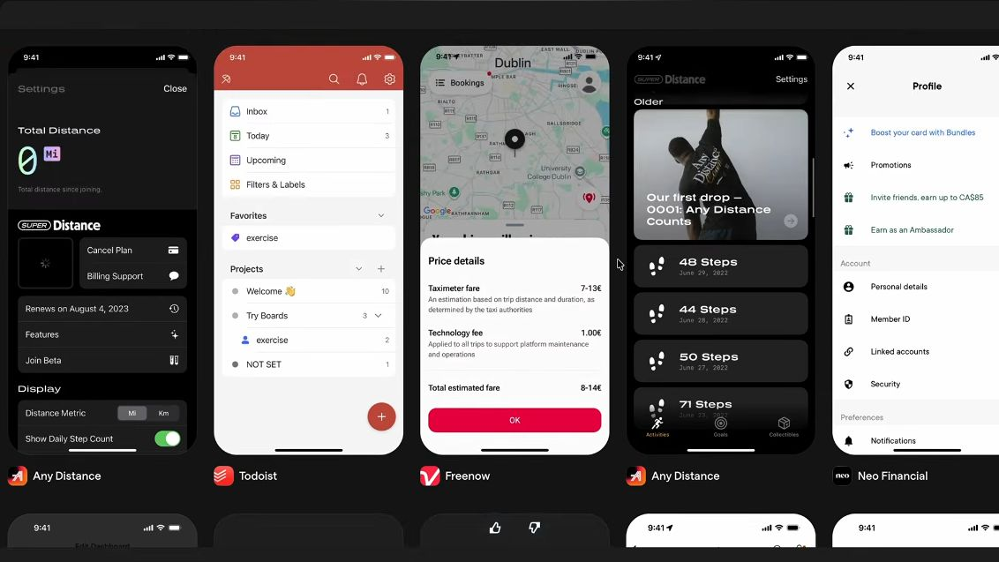

The added video compares settings, lists, and actions while explaining selective attention.

[Video · 4:38](https://www.youtube.com/watch?v=MVOpq3WRnbo&t=278s) — Wyatt Feaster. Recipes and combinations: A09, A10, A11, A12.

## LxLMMuMlJpw

### Consultancy website after revision

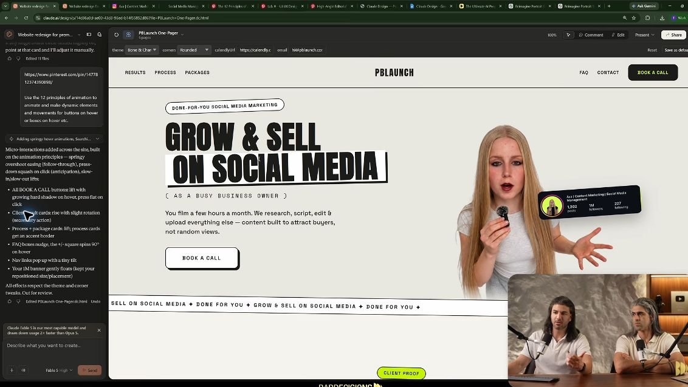

The page retains heading, action, portrait, and continuous strip in the selected visual system.

[Video · 59:11](https://www.youtube.com/watch?v=LxLMMuMlJpw&t=3551s) — Bad Decisions Studio. Recipes and combinations: P10, C07, M08.

## GGg61sdEjeI

### Product identity retained above the catalog

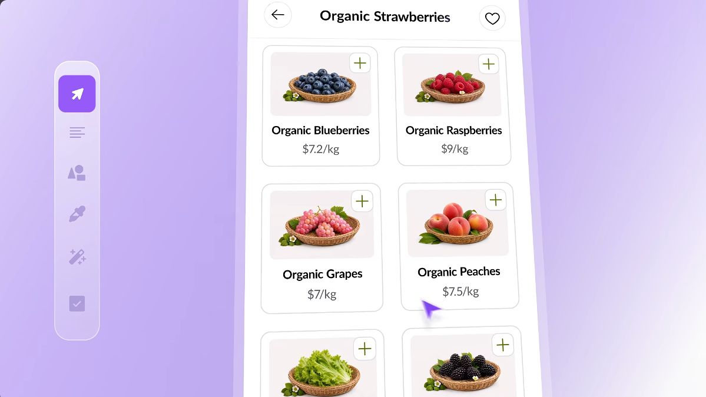

The recording keeps the Organic Strawberries title visible while showing related product cards with unit prices. U07 also links to quantity and purchase-control passages.

[Video · 12:20](https://www.youtube.com/watch?v=GGg61sdEjeI&t=740s) — uxpeak. Recipes and combinations: U07, P08, P09.

## 2TlIg3VokY8

### Useful report findings before saving

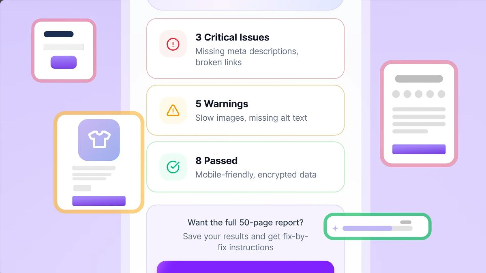

The demonstrated preview exposes critical issues, warnings, and passed checks before offering the saved report. The implemented preview must contain actual findings.

[Video · 4:46](https://www.youtube.com/watch?v=2TlIg3VokY8&t=286s) — uxpeak. Recipes and combinations: U02, U03.

## zr37ibqXl1U

### Booking total and cancellation beside the action

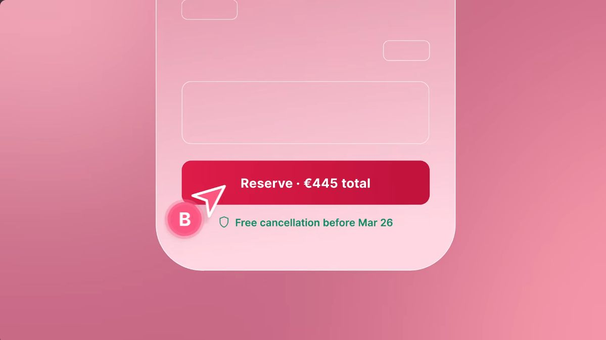

The example places a total and cancellation date at the booking action. These example figures document the composition; U09 derives them from the selected reservation.

[Video · 13:35](https://www.youtube.com/watch?v=zr37ibqXl1U&t=815s) — uxpeak. Recipes and combinations: U09.

## USwP7w9BKC0

### Food search and browse entry

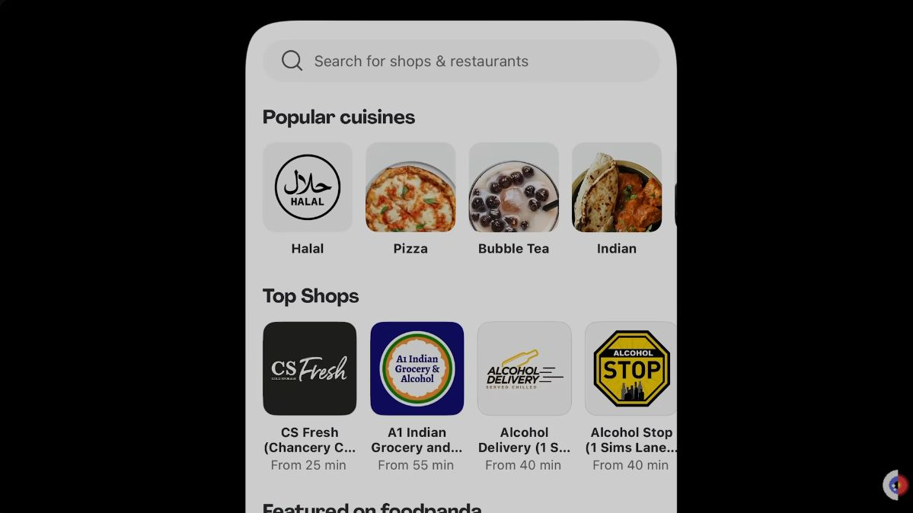

The recording shows the foodpanda search field, cuisine categories, and shop results. Later linked passages compare dish results and unavailable-item choices.

[Video · 12:34](https://www.youtube.com/watch?v=USwP7w9BKC0&t=754s) — Juxtopposed. Recipes and combinations: U10, U11.

## yT_aFozeDc8

### Track identity and playback position

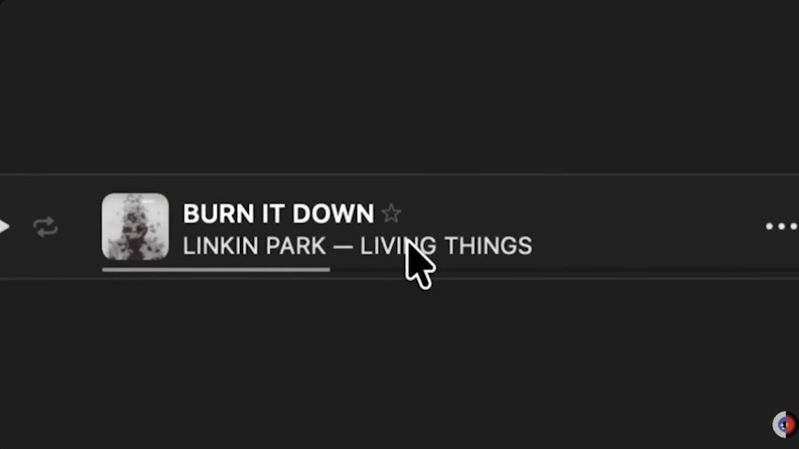

The proposed player shows the active track and a progress line. U14 connects the control area to retained playback and queue state during browsing.

[Video · 17:46](https://www.youtube.com/watch?v=yT_aFozeDc8&t=1066s) — Juxtopposed. Recipes and combinations: U13, U14.

## Ksx9C2-3yMo

### Data table and its secondary controls

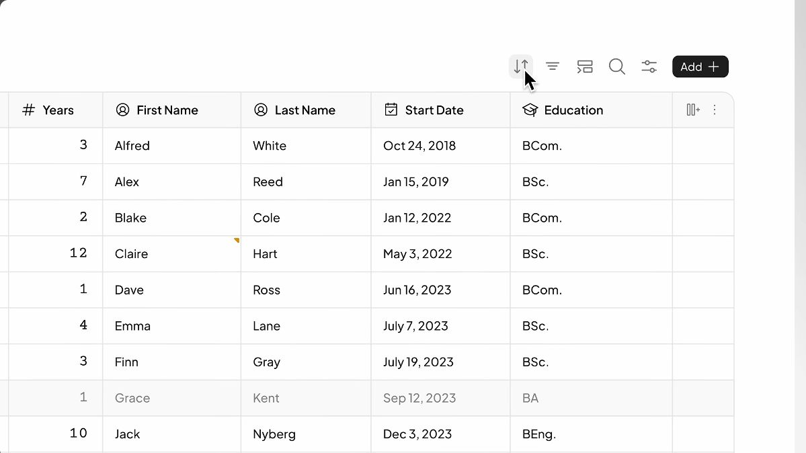

The recording shows aligned numeric values, date fields, and toolbar controls. U15–U16 cover the initial table and the complete states reached through its secondary actions.

[Video · 5:15](https://www.youtube.com/watch?v=Ksx9C2-3yMo&t=315s) — Kole Jain. Recipes and combinations: U15, U16.

## 72xChVM08jI

### Radial distortion around display text

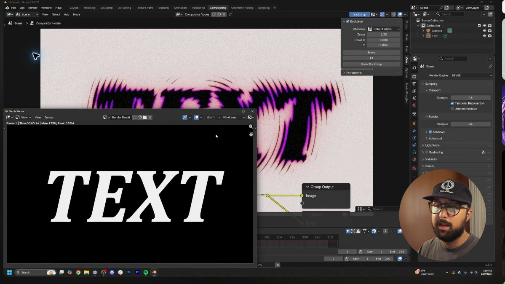

The recording shows the source word and the compositor's ring-like distortion behind it. B01 preserves the editable node procedure and chosen output resolution.

[Video · 6:29](https://www.youtube.com/watch?v=72xChVM08jI&t=389s) — Ducky 3D. Recipes and combinations: B01, B03.

## 72xChVM08jI-875

### Colored halftone letter

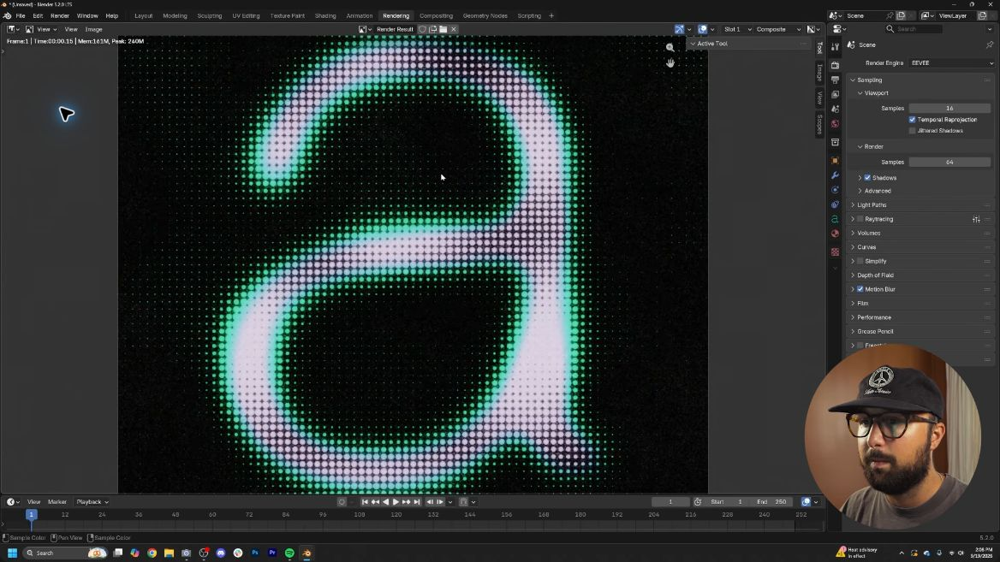

A large letter is rendered as a field of colored dots. B02 links the Voronoi-distance threshold, size remapping, color, and grain steps.

[Video · 14:35](https://www.youtube.com/watch?v=72xChVM08jI&t=875s) — Ducky 3D. Recipes and combinations: B02, B03.

## PDcQJOPby1k

### A feature shown through its product interface

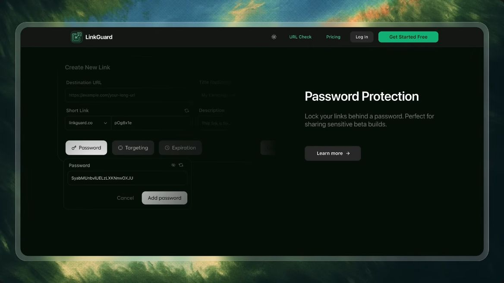

The landing-page example uses the link tool's interface to explain password protection. U20 uses owned example content from the actual product.

[Video · 6:06](https://www.youtube.com/watch?v=PDcQJOPby1k&t=366s) — Kole Jain. Recipes and combinations: U19, U20.

## DBJoepxxQdg

### A product operation in the opening section

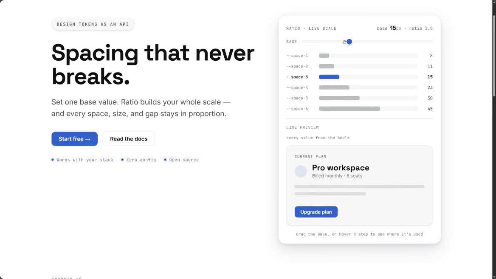

The demonstrated spacing-scale values drive a preview card. P11 makes the product's operation and its result the main interactive example.

[Video · 5:41](https://www.youtube.com/watch?v=DBJoepxxQdg&t=341s) — Sajid. Recipes and combinations: P11, P12.

## OiULPvTJ-0E

### Editable product timing before final styling

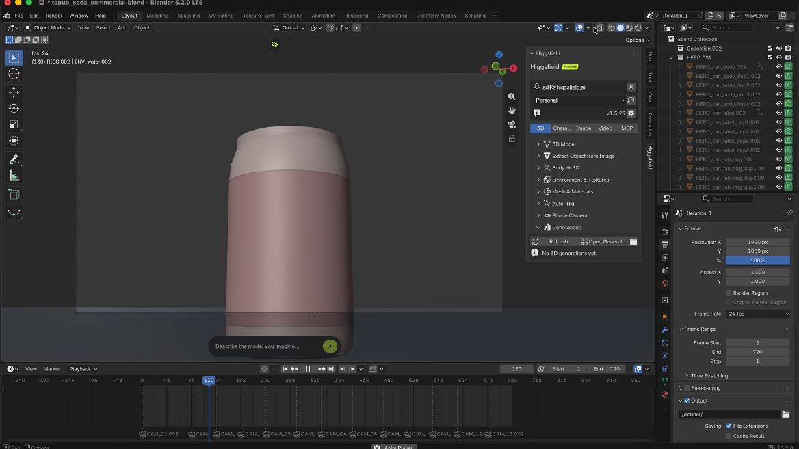

The recording shows a product blockout with simple geometry and a timed sequence. B04–B05 preserve camera and part timing for targeted revisions.

[Video · 14:24](https://www.youtube.com/watch?v=OiULPvTJ-0E&t=864s) — Higgsfield AI. Recipes and combinations: B04, B05.

## q1QQN08ZK6I

### A spherical graphic in a hero concept

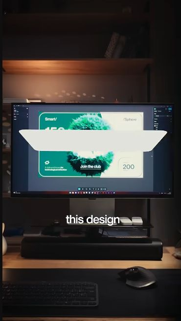

The short presents the completed concept on a monitor before its accelerated construction sequence. B06 adapts the composition to live HTML and a deliberately chosen rendered or interactive asset.

[Video · 0:01](https://www.youtube.com/watch?v=q1QQN08ZK6I&t=1s) — Andrii Bachinskyi. Recipes and combinations: B06.
